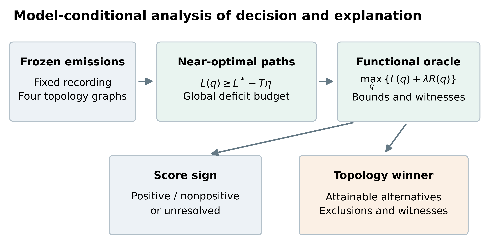
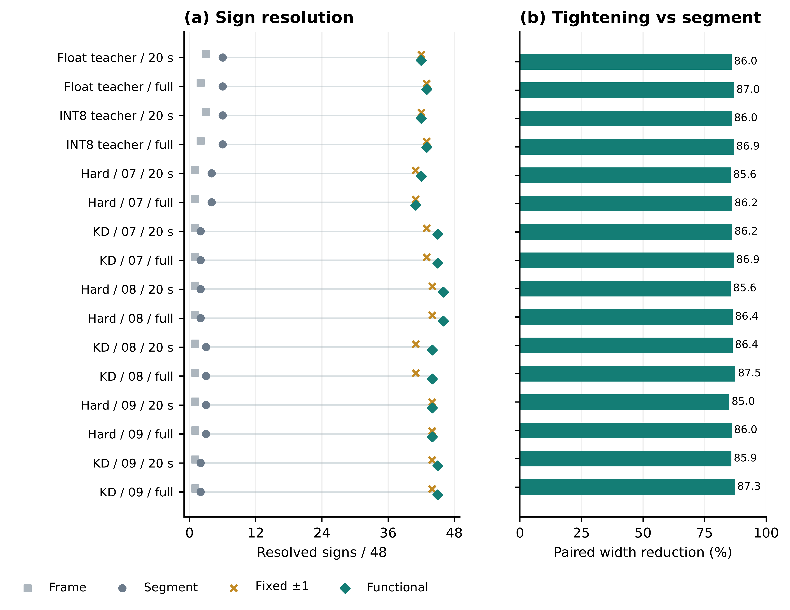

# Heart-sound functional bounds

Research code for **Decision stability and latent explanation ambiguity in neural heart-sound screening: functional bounds and a controlled distillation study**.

The analysis asks whether a model's screening-score sign remains fixed across near-optimal hidden semi-Markov paths, and whether competing murmur explanations remain attainable even when that sign is stable. It combines downstream functional bounds, frame and segment projection controls, explicit feasible witnesses, and a controlled support-gap distillation study.



## Main findings

The initial analysis uses 24 development participants. The breadth analysis uses 48 additional, disjoint development participants evaluated under eight frozen predictors and two recording budgets: **768 repeated conditions, not 768 participants**.

At the normalized path deficit `eta = 0.005`:

| Result | Observed range across the 16 breadth conditions |
| --- | ---: |
| Score signs resolved by functional bounds | 41–46 of 48 |
| Score signs resolved by segment projection | 2–6 of 48 |
| Median paired interval-width reduction | 85.01–87.51% |
| Stable sign with multiple attainable topology winners | 30–39 of 48 |

Both support-gap distillation criteria **failed** across 21 fitted models. Fresh-start support-gap matching had 20.08% higher primary bound error than emission KL. With a common warm start, it remained 4.62% worse than score matching. All arms and seeds are included in the evidence.

These are model-conditional development results. They do not establish clinical superiority, physiological correctness of an explanation, statistical coverage, or a new generic optimization algorithm. See [study scope](docs/study_scope.md).

## Quick start

Clone the repository and verify the deposited files and aggregate arithmetic using Python's standard library:

```bash
git clone https://github.com/mskrcnis/heart-sound-functional-bounds.git
cd heart-sound-functional-bounds
python3 scripts/verify_repository.py
```

To run the numerical code, create a Python 3.10 environment and install the pinned dependencies:

```bash
python3.10 -m venv .venv
source .venv/bin/activate
python -m pip install -r requirements.txt
export OPENBLAS_NUM_THREADS=1
export OMP_NUM_THREADS=1
python examples/synthetic_bounds.py
python scripts/run_tests.py
```

The default test suite uses synthetic inputs only. It checks exhaustive small-graph references, bound containment, feasible witnesses, selection-aware bounds and differentiable queries. PyTorch also checks CUDA when available; a GPU is not required for the default suite.

The dependencies correspond to the numerical stack used in the study. The original experiment used Python 3.8.20 and CUDA-enabled PyTorch 2.4.1; see [reproducibility](docs/reproducibility.md) for the distinction between historical runs and release checks.

## Rebuild tables and figures

```bash
python scripts/reproduce_figures.py
```

This rebuilds four figures and eight LaTeX table fragments from the bundled evidence in `build/reproduced/`. It checks the regenerated table fragments and CSV files against the deposited versions. It does not fit models, access recordings, or overwrite the deposited evidence.



## Optional upstream integration checks

The integration checks use the original Cambridge topology construction at a pinned commit. Read [the third-party notice](THIRD_PARTY_NOTICES.md) before fetching it:

```bash
python scripts/fetch_upstream.py
python scripts/run_tests.py --with-upstream
```

This adds two synthetic integration tests. The historical test that compares against a saved recording-derived posterior is deliberately outside this data-free suite.

## Repository contents

| Path | Contents |
| --- | --- |
| `phase10/src/` | Functional bounds, projection controls, topology/window analysis, distillation, audits and reports |
| `phase10/tests/` | Original numerical and training-helper tests |
| `phase10/configs/` | Frozen distillation configurations |
| `phase10/*PROTOCOL*.txt` | Study protocols, including the declared adaptive warm-start follow-up |
| `phase9/src/` | Baseline and student adapters needed by the experiment code |
| `analysis/evidence/` | Aggregate results, all 21 distillation fits, sanitized breadth records and historical audit summaries |
| `analysis/tables/` | Table fragments regenerated from that evidence |
| `analysis/scripts/` | Original evidence-to-figure/table preparation script |
| `scripts/` | Release verification, synthetic tests, pinned upstream fetch and isolated figure regeneration |
| `provenance/` | Original/exported file hashes and deposited-file integrity manifest |

The `phase9` and `phase10` directory names are retained because the original experiments use these paths in their provenance checks. The broader exploratory workspace is not part of this repository.

## Data and full experiments

The source recordings are [CirCor DigiScope v1.0.3 on PhysioNet](https://doi.org/10.13026/tshs-mw03). Obtain them from the original repository and follow its terms. Recordings, original participant identifiers, fitted weights, posterior caches and witness archives are not redistributed here.

The deposited code supports synthetic algorithm checks and aggregate-result reconstruction. **A fresh clone alone cannot rerun the complete experiments.** Exact reruns require the original frozen input artifacts listed in [experimental inputs](docs/experimental_inputs.md). Their absence is not replaced by the sanitized summary data. Historical audit summaries document checks made in the research checkout; repository verification does not repeat waveform inference or witness rescoring.

## Citation and contact

Citation metadata is in [CITATION.cff](CITATION.cff). The associated manuscript is a research draft; no journal acceptance or article DOI is asserted.

Maintainer: S Kumar Reddy Mallidi, [satya.cnis@gmail.com](mailto:satya.cnis@gmail.com), [ORCID 0000-0001-5908-8316](https://orcid.org/0000-0001-5908-8316).

## License

The software is distributed under the **GAP Available Source License v1.0**, which permits academic noncommercial use under its terms. This is an available-source release, not an unrestricted commercial-use license. The original Cambridge attribution and license are retained. See [LICENSE](LICENSE) and [THIRD_PARTY_NOTICES.md](THIRD_PARTY_NOTICES.md).
